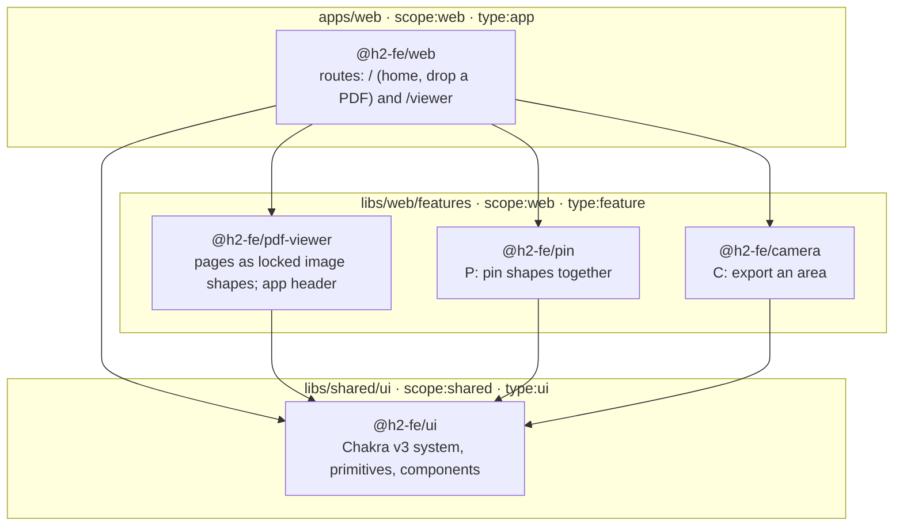

# H2 frontend assessment

A PDF annotation canvas: open a document, mark it, pin shapes together, export a crop.

The five-minute product walkthrough is [docs/reviewer.md](docs/reviewer.md).

## Architecture

Every box is an Nx project, created by a generator and tagged. Arrows are the imports `nx graph` reports. Pin, camera and the PDF viewer never import each other; only the app composes them.



`@nx/enforce-module-boundaries` runs inside oxlint: `scope:shared` may import only `scope:shared`, so the design system can never reach into the app.

### Decisions

| Decision                                                             | Record                                                       |
| -------------------------------------------------------------------- | ------------------------------------------------------------ |
| Nx monorepo, libraries over folders, generators only                 | [0001](docs/decisions/0001-workspace-and-package-manager.md) |
| Vite + React SPA; TanStack Query for loading the PDF                 | [0002](docs/decisions/0002-framework.md)                     |
| tldraw as the canvas engine                                          | [0003](docs/decisions/0003-canvas-engine.md)                 |
| oxlint (type-aware) + oxfmt; boundaries enforced in lint             | [0008](docs/decisions/0008-lint-split.md)                    |
| Sibling feature libs; only the app composes them                     | [0011](docs/decisions/0011-feature-pattern.md)               |
| PDF pages rasterised into locked image shapes                        | [0012](docs/decisions/0012-pdf-pages-as-image-shapes.md)     |
| tldraw and Chakra stay two styling systems, bridged by CSS variables | [0013](docs/decisions/0013-tldraw-chakra-theme-bridge.md)    |
| Chakra UI v3 over Tailwind                                           | [0014](docs/decisions/0014-chakra-over-tailwind.md)          |
| What was left out, on purpose                                        | [0009](docs/decisions/0009-not-built.md)                     |

## Getting started

Requires [Bun](https://bun.sh), [Node.js](https://nodejs.org) 24 (the Nx CLI is a Node script) and Git. Nx needs no global install.

```sh
git clone https://github.com/effinrich/h2-fe-assessment.git
cd h2-fe-assessment
bun install        # root only; also installs the lefthook git hooks
bun run start      # http://localhost:4200
```

## Storybook and Chromatic

```sh
bun run storybook  # the design system, http://localhost:4400
```

`.github/workflows/chromatic.yml` builds this Storybook and publishes it to Chromatic. Accept the invite from the Chromatic dashboard to view it.

## Check

```sh
bun run gate       # nx affected -t lint,format,typecheck,build,build-storybook
```

lefthook runs lint, format and typecheck on commit and the gate on push; CI runs the same gate. Every GitHub Action is pinned to a commit SHA.

## What a reviewer should try

1. Open the example from home. The **‹ / ›** arrows and the page field move between pages.
2. Draw a rectangle. **Open another document** warns before discarding marks.
3. Press **P**, click two overlapping shapes. Drag one: the other follows. Pins do not attach to PDF pages.
4. Press **C**, drag a frame. **Download PNG**, **Copy image**, and **Download SVG** sit on the frame.
5. Toggle color mode. Chrome and the canvas follow it. PNG export stays light.
6. Add `export { AppHeader } from "@h2-fe/pdf-viewer"` to any file in `libs/shared/ui/src/lib`, then run `bunx nx lint shared-ui`. The module-boundary rule fails it.
