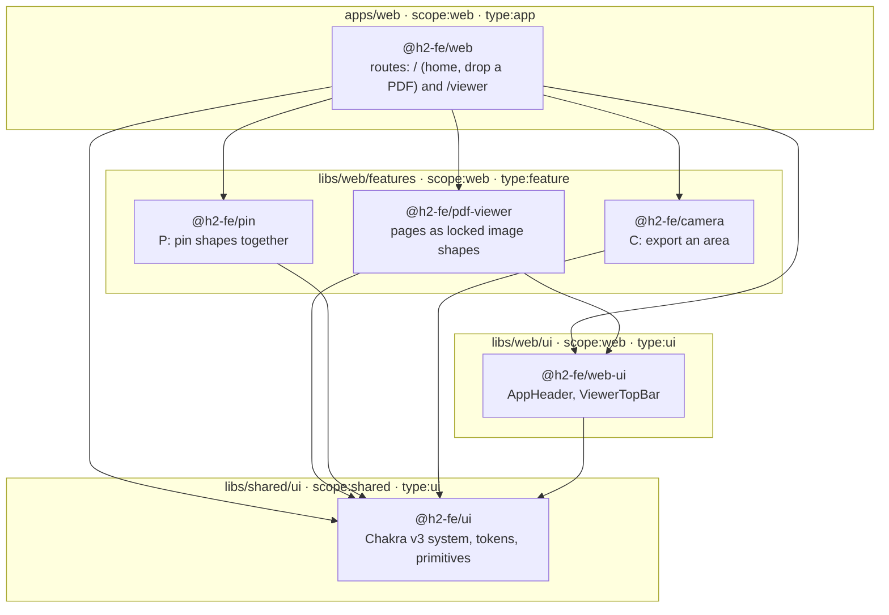
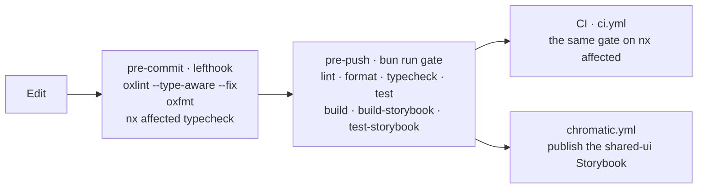

# H2 frontend assessment

A PDF annotation canvas: open a document, mark it, pin shapes together, export a crop.

The five-minute product walkthrough is [docs/reviewer.md](docs/reviewer.md).

## Architecture at a glance

Every box is an Nx project, created by a generator and tagged. Arrows are the imports `nx graph` reports. Pin, camera and the PDF viewer are siblings that never import each other; only the app composes them.



`@nx/enforce-module-boundaries` runs inside oxlint: `scope:shared` may import only `scope:shared`, so the design system can never reach into the app.

### From keystroke to merge



`test-storybook` runs every story in headless Chromium: render, play function, and axe accessibility checks at error level, including stories pinned to a 390×844 phone viewport. Every GitHub Action is pinned to a commit SHA.

### Decisions

| Decision                                                                | Why                                                                                            | Record                                                             |
| ----------------------------------------------------------------------- | ---------------------------------------------------------------------------------------------- | ------------------------------------------------------------------ |
| Nx monorepo, libraries over folders, generators only                    | A queryable project graph; `nx affected` runs only what changed; tags are the architecture map | [0001](docs/decisions/0001-workspace-and-package-manager.md)       |
| Vite + React SPA; TanStack Query only for the PDF fetch and export      | No SSR to pay for; loading, error and retry are real states that stories assert                | [0002](docs/decisions/0002-framework.md)                           |
| tldraw as the canvas engine                                             | Custom shapes, bindings and export are the transferable work                                   | [0003](docs/decisions/0003-canvas-engine.md)                       |
| Chakra UI v3 with typed tokens and recipes                              | Replaced Panda + Park UI; a misspelled token is a type error                                   | [0004](docs/decisions/0004-styling-and-primitives.md) (superseded) |
| Spec first, failing test committed first                                | Each criterion has a test that fails without the change, and the history shows it              | [0005](docs/decisions/0005-sdd-and-tdd.md)                         |
| Every UI component has a story; its play test is its component test     | Interaction, a11y and Chromatic coverage from one file                                         | [0007](docs/decisions/0007-storybook-scope.md)                     |
| oxlint (type-aware) + oxfmt, one tool, boundaries included              | Fast enough for a pre-commit hook; no ESLint                                                   | [0008](docs/decisions/0008-lint-split.md)                          |
| Sibling feature libs; only the app composes them                        | Features ship and test alone                                                                   | [0011](docs/decisions/0011-feature-pattern.md)                     |
| PDF pages rasterised into locked image shapes, off-screen pages evicted | Memory bounded by the viewport; export works; paging never enters undo                         | [0012](docs/decisions/0012-pdf-pages-as-image-shapes.md)           |
| tldraw and Chakra stay two styling systems, bridged by CSS variables    | Chakra for our chrome, tldraw's variables for the canvas; one color mode drives both           | [0013](docs/decisions/0013-tldraw-chakra-theme-bridge.md)          |
| What was left out, on purpose                                           | Scope stated, not implied                                                                      | [0009](docs/decisions/0009-not-built.md)                           |

## Access

1. Accept an invite to the GitHub repo [effinrich/h2-fe-assessment](https://github.com/effinrich/h2-fe-assessment).
2. Accept an invite to the Chromatic project. That invite is sent from the Chromatic dashboard.

After the Chromatic invite, open the project from the dashboard. This repo does not record a public library URL. `chromatic.config.json` names the project as `Project:6abe484afd9c0c336f0e71fb`.

## Getting started

### Requirements

- [Bun](https://bun.sh) — the package manager and script runner. CI uses the latest release.
- [Node.js](https://nodejs.org) 24 — the Nx CLI is a Node script (`#!/usr/bin/env node`), so `bunx nx` still needs Node on your `PATH`. CI pins 24.20.0.
- Git.

Nx does **not** need a global install. It is a dev dependency (Nx 23.2.1), and every command below runs it through `bunx nx`.

### Install

```sh
git clone https://github.com/effinrich/h2-fe-assessment.git
cd h2-fe-assessment
bun install
```

Run `bun install` from the repo root only. Every dependency lives in the root `package.json`. Do not install from an app or library folder.

`bun install` also installs the [lefthook](https://lefthook.dev) git hooks through lefthook's postinstall. Pre-commit lints, formats and typechecks the files you changed. Pre-push runs `bun run gate`. `LEFTHOOK=0 git commit …` skips them for one command.

The Storybook play tests run in headless Chromium. Install it once:

```sh
bunx playwright install chromium
```

### Use Nx

```sh
bunx nx --version                  # local Nx; "Global: Not found" is expected
bunx nx show projects              # @h2-fe/web, @h2-fe/pdf-viewer, @h2-fe/pin, @h2-fe/camera, @h2-fe/web-ui, shared-ui
bunx nx show project @h2-fe/pin    # targets, mostly inferred by plugins, so project.json is not the full list
bunx nx graph                      # the project graph in a browser
bunx nx run @h2-fe/pin:test        # one target on one project (short form: bunx nx test @h2-fe/pin)
bunx nx affected -t lint,test      # only projects changed since the base branch (main)
```

`@h2-fe/source` is the repo root. It has no targets. Nx Cloud is not connected, so the task cache is local to your machine.

## Run the app

```sh
bun run start
```

That script is `nx serve @h2-fe/web`. The serve target runs Vite in `apps/web`. The dev server port is **4200** (`server.port` in `apps/web/vite.config.mts`).

- [http://localhost:4200/](http://localhost:4200/) — drop a PDF or open the example
- [http://localhost:4200/viewer](http://localhost:4200/viewer) — the canvas. Opening `/viewer` with no document redirects home.

## Storybook

Design system (`shared-ui`). The `storybook` target sets port **4400** (`libs/shared/ui/project.json`). Nx appends that option to `storybook dev`.

```sh
bun run storybook
```

[http://localhost:4400/](http://localhost:4400/)

This is the Storybook Chromatic publishes. Its `stories` globs include the design system, pin, camera, pdf-viewer, viewer chrome, and the home route.

Web stage (`@h2-fe/web-ui`):

```sh
bun run storybook:web
```

That target is `storybook dev` with no port. The installed CLI does not default `--port` to a fixed number; it prints the URL when it starts.

Static builds, from the repo root:

```sh
bun run build-storybook
bun run build-storybook:web
```

## Chromatic

[Chromatic’s monorepo docs](https://www.chromatic.com/docs/monorepos) give two ways to publish more than one Storybook:

1. **One Storybook.** List every project’s stories in one `.storybook/main.ts`, and publish that build to a single Chromatic project.
2. **One Chromatic project per Storybook.** Add this GitHub repo again in the Chromatic dashboard, name the new project, and put that project’s token on its own CI job. That needs a second project token. This repo does not have one, so that job is not set up.

This repo uses the first method. `.github/workflows/chromatic.yml` runs `bunx nx run shared-ui:build-storybook` and publishes `dist/storybook/shared-ui` with the existing `CHROMATIC_PROJECT_TOKEN`.

## What a reviewer should try

1. Open the example from home. Page 1 is on the canvas. The **‹ / ›** arrows and the page field in the header move between pages without redrawing the ones you cannot see.
2. Draw a rectangle. **Open another document** warns before discarding marks. Cancel keeps the canvas.
3. Press **P**, click two overlapping shapes. Drag one: the other follows. Pins do not attach to PDF pages.
4. Press **C**, drag a frame. **Download PNG**, **Copy image**, and **Download SVG** sit on the frame. An empty frame disables the actions.
5. Toggle color mode. Chrome and the canvas follow it. PNG export stays light.
6. Back on home, drop a PDF anywhere on the page: it opens like a picked file. Drop an image or two files instead: a toast refuses them and nothing navigates.
7. Break the architecture on purpose. Add `export { AppHeader } from "@h2-fe/web-ui"` to any file in `libs/shared/ui/src/lib`, then run `bunx nx lint shared-ui`. `@nx/enforce-module-boundaries` fails it before a test runs. `bunx nx graph` draws the same map as the diagram above.

## Stack

Nx 23 + bun · Vite · React 19 · TypeScript strict · Chakra UI v3 · TanStack Query · tldraw 5.5 · Storybook 10 · Vitest

`apps/web` hosts routes. Home is `apps/web/src/app/routes/home`, not a feature library. Feature libraries are `libs/web/features/*`. The design system is `libs/shared/ui` (`@h2-fe/ui`). Pin, camera, and the PDF viewer do not import each other. The viewer route composes pin and camera.

Specs: [docs/specs](docs/specs). Decisions: [docs/decisions](docs/decisions). What was left out: [ADR 0009](docs/decisions/0009-not-built.md).

## Check

```sh
bun run gate
```

That is `nx affected` for lint, format, typecheck, test, build, Storybook build, and Storybook play tests.

Pieces of it, from the repo root:

```sh
bun run test                                  # every Vitest (jsdom) suite
bun run lint                                  # oxlint, type-aware, every project
bun run format                                # oxfmt check
bunx nx run @h2-fe/web-ui:test-storybook      # app and feature stories in Chromium
bunx nx run shared-ui:test-storybook          # design-system stories in Chromium
```
