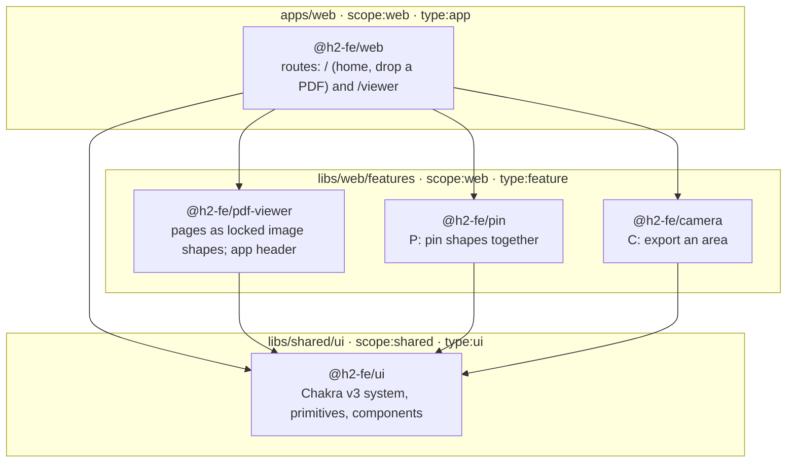

# H2 frontend assessment

A PDF annotation canvas: open a document, mark it, pin shapes together, export a crop.

A narrated walkthrough of the product, ninety-eight seconds, is in [docs/media.mp4](docs/media.mp4) and written out in [docs/reviewer.md](docs/reviewer.md).

## Reviewing this

You have read access to this repository. Everything you need is here:

1. Watch the [walkthrough video](docs/media.mp4) — ninety-eight seconds, narrated, 1920x1080. It plays in GitHub's own player.
2. Read [docs/reviewer.md](docs/reviewer.md) — the walkthrough, written out.
3. Run it: `bun install`, then `bun run start`, then open http://localhost:4200/.
4. Ask questions or leave findings in [Discussions](https://github.com/effinrich/h2-fe-assessment/discussions). That is where I will look for them.
5. Read [docs/safeguards.md](docs/safeguards.md) if you want to know what protects this repository's own agent instructions and hooks, and what that protection is for.

If you would rather have the file, the same recording is attached to the [reviewer-walkthrough-v2 release](https://github.com/effinrich/h2-fe-assessment/releases/tag/reviewer-walkthrough-v2) and downloads as an MP4.

The "Get a license for production" button in the bottom right of the canvas is tldraw's own licensing prompt. This repository ships without a production license key, so the SDK shows that badge wherever it runs.

## Architecture

Every box is an Nx project, created by a generator and tagged. Arrows are the imports `nx graph` reports. Pin, camera and the PDF viewer never import each other; only the app composes them.



`@nx/enforce-module-boundaries` runs inside oxlint: `scope:shared` may import only `scope:shared`, so the design system can never reach into the app.

### Decisions

| Decision                                                             | Record                                                       |
| -------------------------------------------------------------------- | ------------------------------------------------------------ |
| Nx monorepo, libraries over folders, generators only                 | [0001](docs/decisions/0001-workspace-and-package-manager.md) |
| Vite + React SPA; TanStack Query for loading the PDF                 | [0002](docs/decisions/0002-framework.md)                     |
| tldraw as the canvas engine                                          | [0003](docs/decisions/0003-canvas-engine.md)                 |
| Panda CSS with Ark UI, later replaced by Chakra UI v3                | [0004](docs/decisions/0004-styling-and-primitives.md)        |
| Typed judgement for the gates a compiler cannot write (proposed)     | [0006](docs/decisions/0006-judgement-layer.md)               |
| oxlint (type-aware) + oxfmt; boundaries enforced in lint             | [0008](docs/decisions/0008-lint-split.md)                    |
| Nx dependency trims: a verification protocol and a ledger            | [0010](docs/decisions/0010-nx-dependency-trims.md)           |
| Sibling feature libs; only the app composes them                     | [0011](docs/decisions/0011-feature-pattern.md)               |
| PDF pages rasterised into locked image shapes                        | [0012](docs/decisions/0012-pdf-pages-as-image-shapes.md)     |
| tldraw and Chakra stay two styling systems, bridged by CSS variables | [0013](docs/decisions/0013-tldraw-chakra-theme-bridge.md)    |
| Chakra UI v3 over Tailwind                                           | [0014](docs/decisions/0014-chakra-over-tailwind.md)          |
| What was left out, on purpose                                        | [0009](docs/decisions/0009-not-built.md)                     |

0005 and 0007 were removed with the test harness in #43 — testing is not required by the brief. The numbers are left alone so the record reads as a history rather than a rewrite. The per-library Storybook and the story-per-component rule from 0007 are still in force.

## Getting started

Requires [Bun](https://bun.sh), [Node.js](https://nodejs.org) 24 (the Nx CLI is a Node script) and Git. Nx needs no global install.

```sh
git clone https://github.com/effinrich/h2-fe-assessment.git
cd h2-fe-assessment
bun install        # root only; also installs the lefthook git hooks
bun run start      # http://localhost:4200
```

## Storybook and Chromatic

```sh
bun run storybook  # the design system, http://localhost:4400
```

`.github/workflows/chromatic.yml` builds this Storybook and publishes it to Chromatic on every push; the preview link is on the pull request checks. The published Storybook is public and needs no account: [main--6abe484afd9c0c336f0e71fb.chromatic.com](https://main--6abe484afd9c0c336f0e71fb.chromatic.com) always serves the latest build from `main`. If you would rather not use an account at all, `bun run storybook` serves the same Storybook locally on http://localhost:4400.

## Check

```sh
bun run gate       # size budget, guardrails, then nx affected -t lint,format,typecheck,build,build-storybook
```

lefthook runs lint, format and typecheck on commit and the gate on push; CI runs the same gate. Every GitHub Action is pinned to a commit SHA.

The agent instructions, the git hooks and the guardrail manifest that checks them are protected by `tools/guardrails.mjs`, which runs in the gate and in its own `Guardrails` check. `.github/CODEOWNERS` puts them behind the owner's review, and `main` requires both checks. [docs/safeguards.md](docs/safeguards.md) is the record of what is protected, what the branch ruleset does, and what was found this way.

## What a reviewer should try

1. Open the example from home. The **‹ / ›** arrows and the page field move between pages.
2. Draw a rectangle. **Open another** (top right) warns before discarding marks.
3. Press **P**, click two overlapping shapes. Drag one: the other follows. Pins do not attach to PDF pages.
4. Press **C**, drag a box. Releasing downloads it as a PNG; hold **Ctrl** to copy it instead.
5. Toggle color mode. Chrome and the canvas follow it. The page and your marks keep their colors, but a crop taken in dark mode carries the dark background with it.
6. Add `export { AppHeader } from "@h2-fe/pdf-viewer"` to any file in `libs/shared/ui/src/lib`, then run `bunx nx lint shared-ui`. The module-boundary rule fails it.
